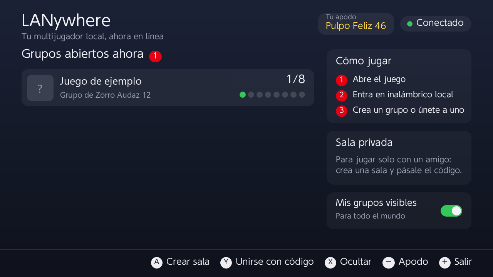
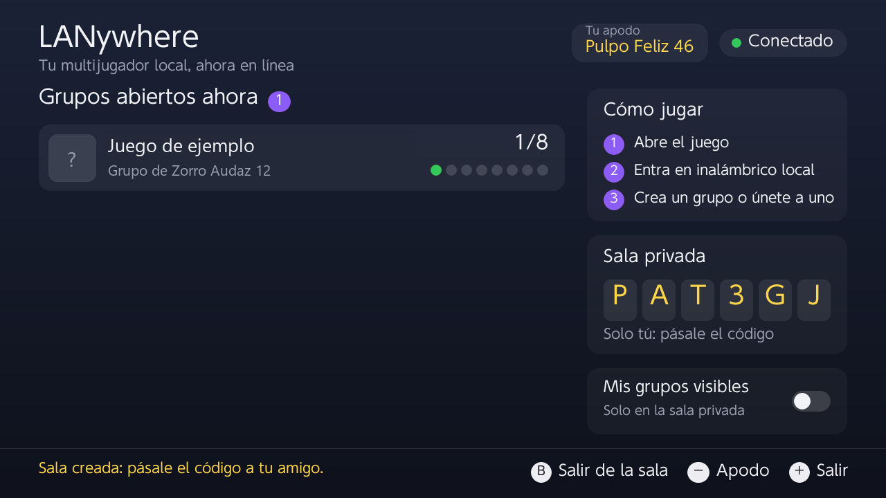

# LANywhere

[Español](README.es.md) · **English** · 🌐 **[lanywhere.online](https://lanywhere.online)**: open groups right now

> 🧪 **Beta: we are looking for testers.** Full matches already work between a console and two emulators, but we
> still need to test between real consoles in different homes. If you try it, tell us how it went (even if it failed) with a
> [test report](../../issues/new?template=test-report.yml). Tested games so far are listed in the
> [beta issue](../../issues?q=label%3Abeta).

### Your local multiplayer, online.

Local multiplayer, but your friends don't have to be in the room. LANywhere takes the **local wireless mode** of your
games to the internet: no PC, no setup, no IPs to type.

Create a group in the game as usual ("local wireless" → "create group") and players anywhere in the world can join;
search for groups and you'll see the ones open online. To play only with a friend, use a private room with a 6-letter
code. You can also play **from a PC with the Ryujinx emulator**, in the same groups as the consoles.

> Independent, non-profit project, not affiliated with any console or game maker. It only carries the network traffic
> of the local wireless mode over the internet: it does not modify games, does not use keys or accounts, and does not
> give access to any official online service.



### LANywhere or an online-service replacement?

LANywhere is about the **local wireless mode**: it works with **any game that has one**, from day one, without patching
games or creating accounts. Projects such as [Nextendo Network](https://nextendo.network) take a different route: they
reimplement a game's **online mode** (worldwide matchmaking, friends, rankings) one game at a time. If your game is
supported there, its online mode will give you the fuller experience; for everything else with local wireless play,
use LANywhere. The two are complementary.

## Requirements

- A console running **Atmosphère 1.12.x**.
- **Nothing else to set up:** LANywhere uses the project's public server, which is already up and running. You don't
  need your own server, a PC or to type any IP.
- **Wi-Fi with internet access.**
- The **same game and the same version** as the other players (just like real local wireless play).

## Installation

1. Download `lanywhere-<version>.zip` from [Releases](../../releases).
2. Unzip it to the **root of the SD card** (allow it to replace files; if you had ldn_mitm, it gets replaced).
3. Restart the console.
4. Open **LANywhere** from the homebrew menu: the top right corner should say **Connected**.

## How to play

1. Open the game.
2. Go to its **local wireless** mode (in some games, "local play").
3. **Create a group** (everyone will see it) or **search** for one to join.

The **LANywhere** app shows the groups open right now, your nickname and the private room. It follows the console's
language: Spanish for Spanish, English otherwise.

Everything can be used with the touch screen too.

| Button | What it does |
|---|---|
| Tap a group (or ↑ ↓) | Pick an open group; **A** (or tapping it again) opens its game, and that group is the one waiting for you in "search for groups" |
| A | Create a private room: you get a code to share with your friend |
| Y | Join a private room with its code |
| B | Leave the private room |
| X | Show or hide your groups to the rest of the world |
| − | Change your nickname |

While you are in a private room, your groups are only visible to that room.



**If the player who created the group leaves, the match ends for everyone.** That's how games' local mode works: the
host is the group's network. If anyone else leaves, the rest keep playing. The player with the most stable connection
should create the group.

## With an emulator (Ryujinx)

A PC running Ryujinx can play with consoles in the same groups, with nothing else to install: LANywhere speaks the
**LAN Play** protocol. You need a Ryujinx version with the "LAN Play" multiplayer mode.

1. In Ryujinx: **Options → Settings → Network**.
2. **Mode:** `LAN Play`. **LAN Play server:** `129.38.114.182`. **Virtual IP:** automatic. Keep "Enable guest
   internet access / LAN mode" checked.
3. Open the game and go to its local wireless mode: the consoles' groups show up when you search, and a group you
   create in Ryujinx shows up on the consoles (and on [lanywhere.online](https://lanywhere.online)).

Everyone needs the same game and the same version, as between consoles. Emulators don't use private rooms: they meet
in open groups.

## Safety and privacy

- **A nickname, never your user name.** Other players see you by a nickname (a random one until you pick your own).
  The server filters offensive nicknames.
- ⚠️ **Inside the match**, some games show the console's user name, because the game itself sends it. To play with
  strangers, **create a user on the console with a nickname** and play with it.
- **Nobody sees your IP.** Everything goes through the server; other players only see a virtual IP (10.13.x.x).
- **No chat**: local wireless games don't have one, and LANywhere doesn't add any.
- **Keep your games updated.** With open groups you receive data from unknown consoles, like in any online game; some
  old games had serious network bugs that were fixed in their updates.
- If you'd rather stay within your circle: press **X** in the app to hide your groups and use private rooms.

## How it works

```
 game ──ldn──▶ sysmodule (ldn_mitm fork) ──TCP/UDP 11460──▶ room server ◀── other consoles
                                                                  ▲
                                         Ryujinx ──LAN Play, UDP 11451──┘
```

- **Sysmodule** (`console/`): a fork of [ldn_mitm](https://github.com/spacemeowx2/ldn_mitm). It replaces the system's
  `ldn` (local wireless) service; groups are published, found and joined through the server, and the game's packets
  for the room's virtual network are relayed by it.
- **Server** (`server/relay/server.js`): Node.js, no dependencies. Rooms of up to 8 consoles, open groups, automatic
  reconnection when Wi-Fi drops, abuse limits and a monthly traffic cap. It includes a LAN Play gateway
  (`lanplay.js`) for emulators.
- **App** (`app/`): the LANywhere panel.

The protocol is described (in Spanish) in [docs/PROTOCOL.md](docs/PROTOCOL.md).

## Your own server (optional)

**You don't need this to play.** LANywhere comes ready to use the project's public server, which is already running.
This section is only for those who want to host their own (for example, a server closer to their region). To use
another server, create `sdmc:/lanywhere/config.ini`:

```ini
server=1.2.3.4
port=11460
```

Any small Linux virtual machine works, in the cloud or at home; for example an AWS `t4g.small` instance or similar.
Minimum requirements:

- 1 vCPU and 1 GB of RAM (the server itself uses a few tens of MB).
- Ubuntu 22.04 or 24.04 (or another distribution with Node.js 18 or newer).
- A public IP and **TCP and UDP port 11460** open in the provider's firewall (plus **UDP 11451** for emulators).
- ⚠️ **UDP fragments:** large game packets travel fragmented and only the first fragment carries the port. If the
  provider's firewall filters UDP by port, it drops the rest and some games get stuck waiting (for example, when
  picking a track). Allow **UDP without port filtering** in the provider's firewall: the machine's own firewall
  (set up by `deploy-relay.ps1`) still filters by port after reassembly.
- What matters most is **outbound traffic**: all game traffic goes through the server. Set `LANYWHERE_CAP_GB` to what
  your plan includes to avoid surprises.

The server is a single file: `node server/relay/server.js --port 11460`. Environment variables: `LANYWHERE_CAP_GB`
(monthly outbound traffic cap, 8000 by default; once reached, it pauses until next month) and `LANYWHERE_STATE_DIR`
(where the counter is stored).

To install it as a service on Ubuntu (with SSH key access):

```powershell
.\scripts\deploy-relay.ps1 -VmHost <VM IP> -Key $HOME\.ssh\my_key
```

It installs Node.js if missing and sets the server up as a sandboxed systemd service (no privileges), with automatic
security updates. It also turns off the "don't fragment" bit for UDP: on clouds with a large internal MTU (9000), a
packet with that bit set gets lost on the internet. Recommended: allow SSH only from your IP.

### Activity dashboard

The server comes with an activity dashboard: connected consoles, rooms, open groups per game, monthly traffic against
the cap, charts for the last 24 hours and the last 30 days, counters and recent activity. It only listens inside the
server (`127.0.0.1:11461`), so no new port is opened; you view it from your PC through an SSH tunnel:

```powershell
.\scripts\panel.ps1 -VmHost <VM IP> -Key $HOME\.ssh\my_key
```

Everything is aggregated: no IPs or personal data (only nicknames and room codes). To see names instead of game ids,
create `games.json` in the state directory, for example `{"0100000000ABC000": "My game"}`.

## Building

With [devkitPro](https://devkitpro.org) (devkitA64 and libnx):

```sh
git submodule update --init --recursive   # Atmosphere-libs (1.12.1) and libtesla
make -C console                           # sysmodule → console/out/sd
make -C app                               # app → app/lanywhere.nro
```

```powershell
.\scripts\package.ps1 -Version 0.1.0     # dist\lanywhere-0.1.0.zip
```

Server tests: `node server/relay/test.js` and `node server/relay/test-lanplay.js` (LAN Play gateway). To test with a single console, `server/relay/fake-peer.js` simulates another
player (`--abiertas`: finds and joins an open group; `--anfitrion`: publishes a group).

Debugging on the console: `sdmc:/lanywhere/relay.log` (always, up to 256 KB) and, if the file `sdmc:/lanywhere/debug.flag`
exists, also `bsd.log` with the game's sockets.

## Contributing

Translations, servers in other regions (lower latency for players far from the default one) and reports of which games
work are all welcome: open an issue or a pull request.

## Credits and license

- [ldn_mitm](https://github.com/spacemeowx2/ldn_mitm) by spacemeowx2 and contributors: the base of the sysmodule.
- [Atmosphère](https://github.com/Atmosphere-NX/Atmosphere) and libnx.
- [libtesla](https://github.com/WerWolv/libtesla) (ldnmitm_config overlay).

GPL-2.0, like ldn_mitm: see [LICENSE](LICENSE).
